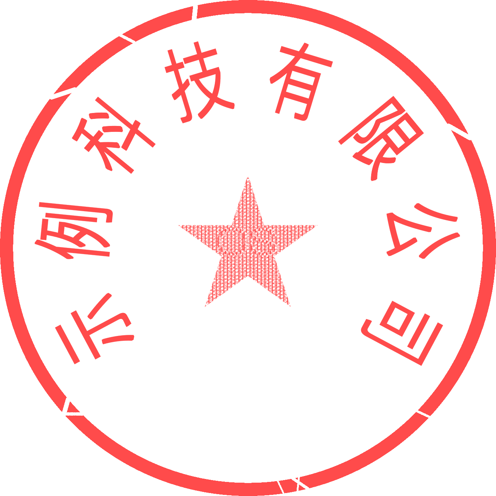
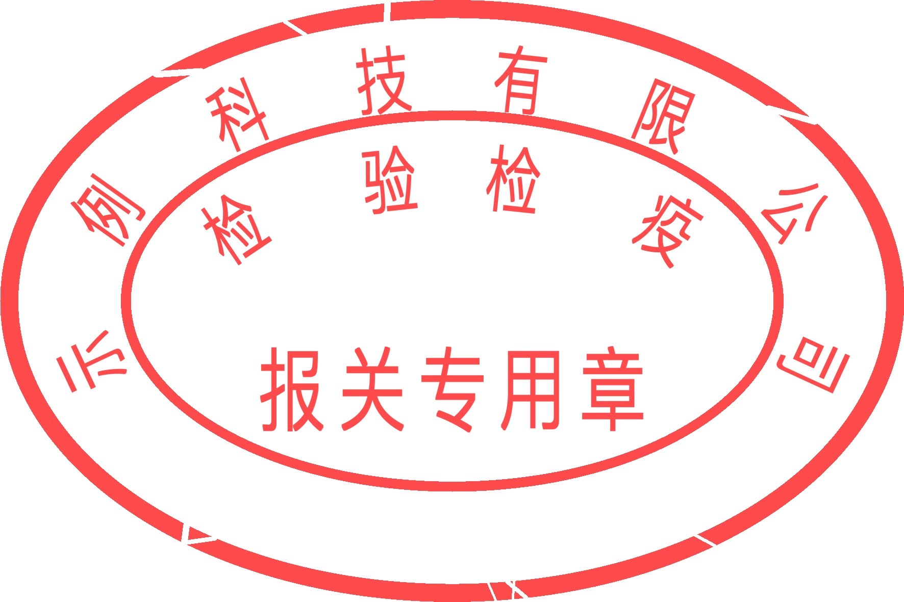
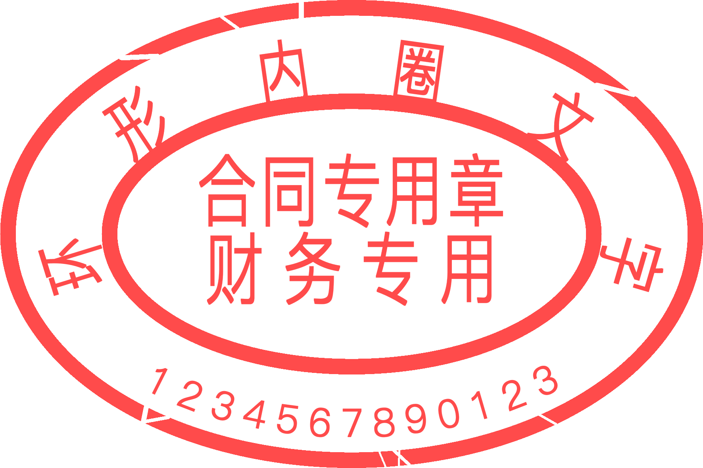
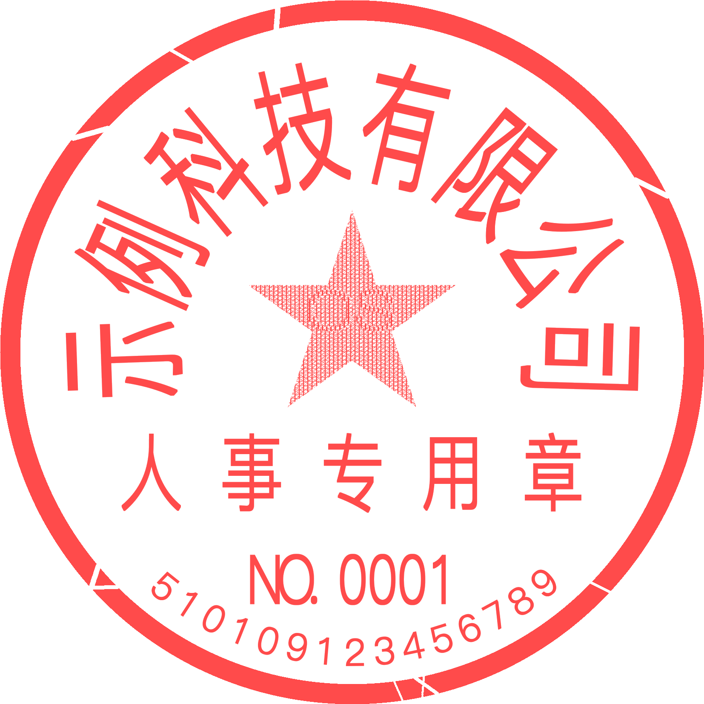
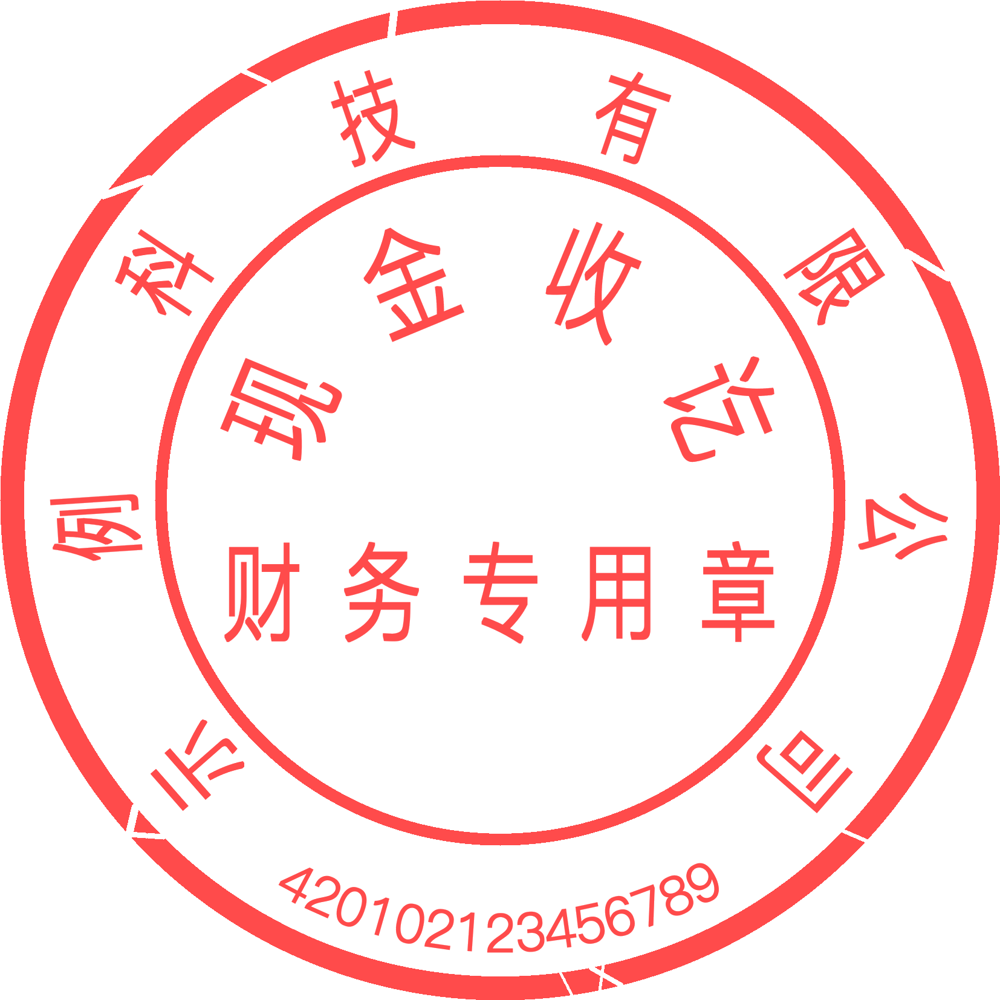
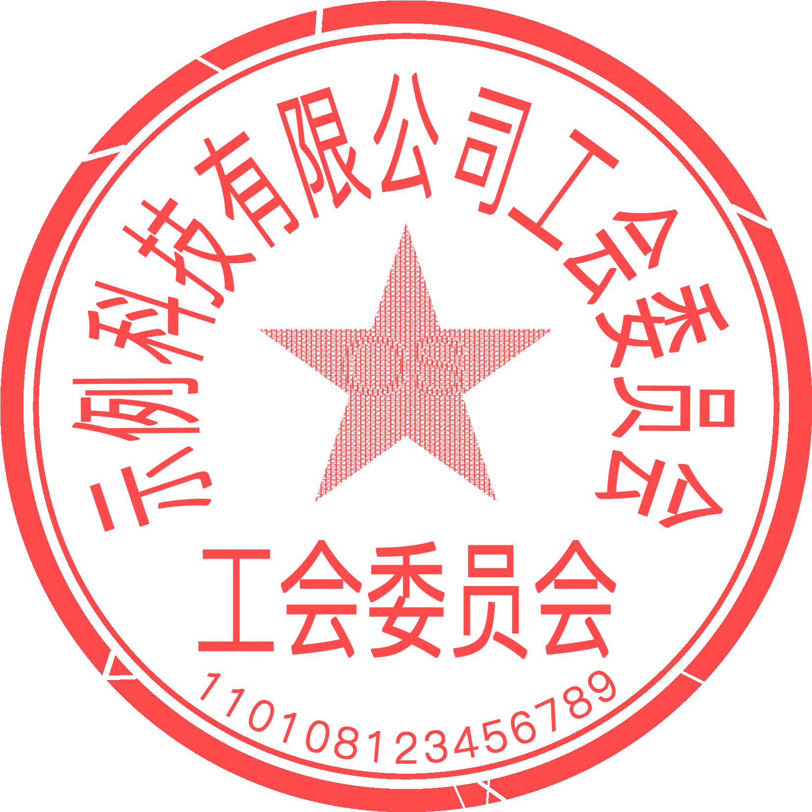
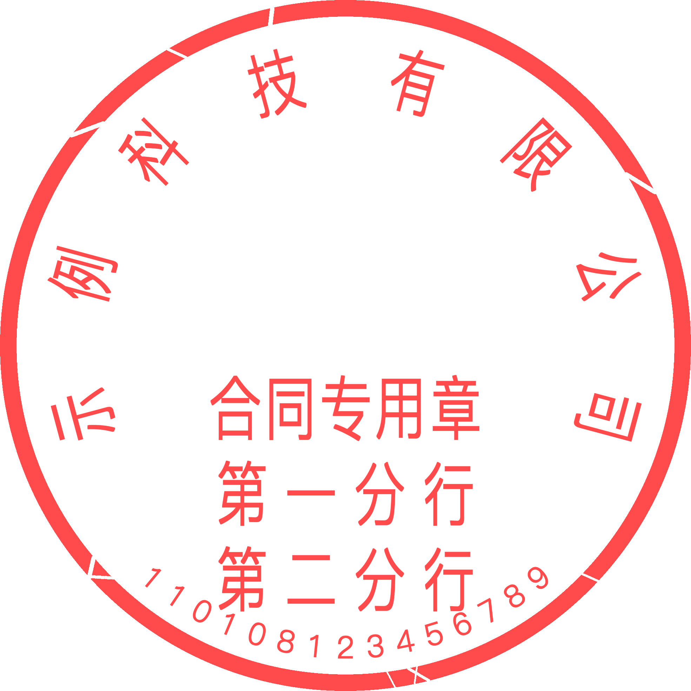
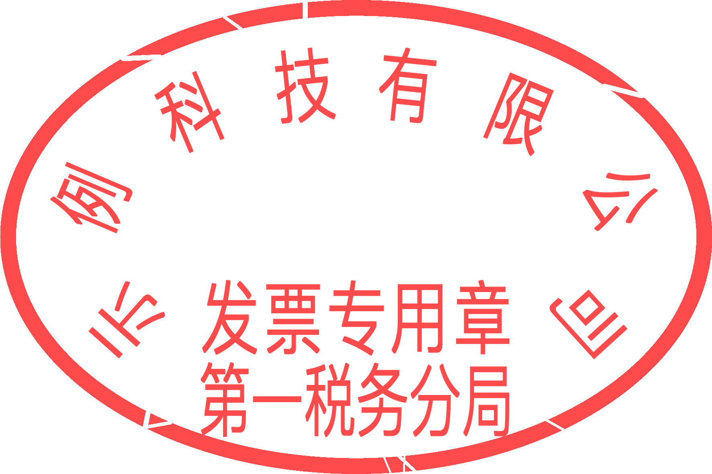
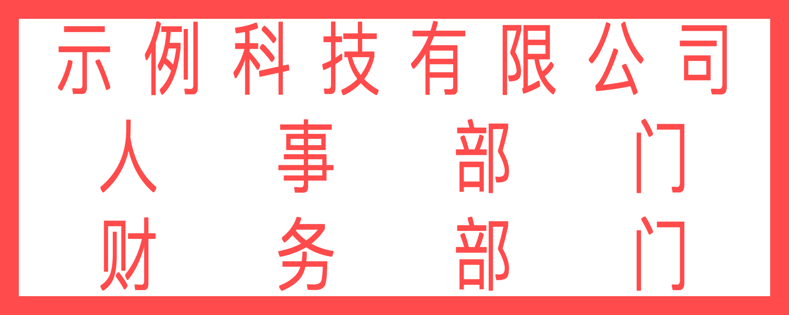

# official-seal

**official-seal** is a Go library for **rasterizing Chinese enterprise and organization seal (chop) artwork**. It generates transparent PNG seal images locally from category, physical size, and text parameters—suitable for e-signature previews, contract stamping, and seal production pipelines.

Integrators should depend only on the public **`seal`** package. Drawing and rendering live under `internal/` and are not importable from outside this module tree.

- Module: `github.com/bytodream/official-seal-open`
- Go: 1.25+

---

## Features

| Feature | Description |
|---------|-------------|
| **Seal rendering** | Pure Go vector-style drawing → PNG; multiple standard categories and mm-based specs |
| **Service layer** | `CompanySealCreateService`: preview, sharp/blur image generation, storage keys |
| **Layout options** | Arc text, foot lines, enterprise code arc, inner text, multi-row footers, center logo, anti-forgery marks |
| **Fonts** | `OFFICIAL_SEAL_FONTS_PATH` or built-in fallback font |
| **Random seed** | `OFFICIAL_SEAL_RANDOM_SEED`: a non-zero integer makes anti-fake lines and blur reproducible (useful for image regression); unset means random per run |
| **Licensing** | `OS_LICENSE` / `SetLicenseKey`; allowed categories are determined solely by `seal_categories` in the license (no categories if unset) |
| **Usage counting** | Each successful non-sample draw counts once (when `UsageLimit>0`), recorded in `OS_USAGE_FILE` (default `~/.official-seal/usage.json`); this file is a local plaintext record — an honest client-side model, use your own billing on the server |
| **Crypto helpers** | RSA hybrid seal/encrypt in `internal` (for license issuance tools) |

---

## Public API (`seal` package)

Load a license before generating seals:

```go
import "github.com/bytodream/official-seal-open/seal"

_ = seal.SetLicenseKey(os.Getenv("OS_LICENSE"))
```

| API | Purpose |
|-----|---------|
| `SetLicenseKey` / `GetLicenseKey` | Load and inspect license |
| `CompanySealCreateService.Preview` | Preview PNG from `SealModel` |
| `CompanySealCreateService.GetAutoSealImage` | Sharp + blurred images and upload keys |
| `CompanySealCreateService.RenderAttributePNG` | PNG from `CustomSealAttribute` |
| `CompanySealCreateService.InitSealPermission` | Verify license is active |

License and seal **category** checks run in the service layer only. The renderer is fixed to `CommonSealGenerator` (no pluggable generator).

### Integration notes

- Import **`github.com/bytodream/official-seal-open/seal`** only; use exported `SealModel`, `CustomSealAttribute`, etc. Do not import `seal/model` or `seal/internal` (`seal/utils` is a public utility package).
- Use **`ParseSealModelFromCreateJSON`** for create-seal JSON, then `Preview`.
- **`ToSealAttributeFunc`** is not supported on the service-layer attribute (JSON bridge only); build fields before calling the API.

---

## Architecture

```
seal/                 Public facade (aliases service)
├── alias.go          Facade aliases: types, errors, spec constants
├── doc.go            Package doc
├── cmd/              Helper commands (e.g. showcase generation)
├── service/          Services + license
│   └── dto/          Integration DTOs; ToDomain → kernel model
├── model/            Kernel domain types
├── utils/            Shared utilities (pixel conversion, logging, license, IoC)
└── internal/         Internal implementation
    ├── draw/         Seal painting (base shared layer + self-contained per-category modules)
    ├── render/       PNG rendering and image effects
    └── private/      License key encoding
```

Prefer importing `seal` or `seal/service/dto` for stable APIs.

### Self-contained drawing modules

Each category lives in `seal/internal/draw/module/<category>/` and ships its own copy of every drawing routine it needs (`core_impl.go`), importing no other category package. The parts of `enterprise` that reuse oval logic are likewise copied into `oval_impl.go`.

- **Per-category delivery**: licensing a single category only requires that directory plus the shared layer (`base`, `model`, `utils`) — no other category code is exposed
- **Zero cross-category imports**: no two packages under `draw/module` import each other
- **Sync cost**: changes to shared drawing logic must be applied to all copied variants

The shared `base` layer keeps only what every category builds on: seal attributes, paint model, font resolution, random source and transparency conversion.

---

## Seal previews

Sample PNGs rendered by this library (demo company name: **示例科技有限公司**). Files live under `docs/images/seals/`.

| Type | Preview |
|:-----|:-------:|
| Enterprise circle 42mm |  |
| Enterprise circle 34mm |  |
| Enterprise oval |  |
| Double-line oval |  |
| Double-line circle |  |
| Double circle |  |
| Party committee |  |
| Trade union |  |
| Youth League |  |
| Multi-row circle |  |
| Multi-row oval |  |
| Multi-row rectangle |  |
| DIY enterprise 43mm |  |

---

## Seal categories (`SealCategory`)

All categories defined in code. Previews above cover the mainstream common layouts; the remaining categories are built by the per-category modules (`seal/internal/draw/module`) and can be enabled per model under a commercial license.

| Value | Name | Description |
|-------|------|-------------|
| `enterprise` | Enterprise circular | Standard round company seal; arc company name, optional foot line and enterprise code, center logo, anti-forgery |
| `OVAL` | Enterprise oval | Oval outline; optional foot line and inner oval text |
| `doubleline_cir` | Double-line circular | Circle with horizontal head line and foot line |
| `doubleline_oval` | Double-line oval | Oval with two horizontal rows and optional inner ring/oval text |
| `double_cir` | Double-circle | Two concentric circles; outer arc text, inner text |
| `communist` | Party committee | CPC committee seal style |
| `labour` | Trade union | Labour union circular seal |
| `youth_league` | Youth League | Communist Youth League layout |
| `more_foot_circle` | Multi-row circular | Circle with multiple horizontal footer rows |
| `more_foot_oval` | Multi-row oval | Oval with multiple horizontal rows |
| `more_foot_rectangle` | Multi-row rectangle | Rectangle with multiple horizontal rows |
| `rectangle` | Rectangle | Plain rectangular seal |
| `square` | Square | Square seal |
| `CPPCC` | CPPCC | Chinese People’s Political Consultative Conference seal |
| `rectangle_timestamp` | Timestamp rectangle | Timestamp-style rectangle |
| `csj_shusp` | Yangtze Delta integrated | Yangtze River Delta “one network” style |
| `public_security` | Public security / justice | Public security and judicial seal family |
| `double_oval` | Double oval | Double-oval layout |
| `archives` | Archives | Archives seal |
| `rectangle_land` | Land planning | Land / planning authority square seal |
| `purpose_seal` | Purpose seal | General-purpose chop type |

### Common specs (`SealSpec`)

| Spec | Meaning |
|------|---------|
| `CIRCULAR_42` | 42 mm diameter circle (default) |
| `CIRCULAR_34` | 34 mm diameter circle |
| `CIRCULAR_50` | 50 mm diameter circle (often used with multi-row circle) |
| `OVAL_45_30` | 45×30 mm oval |
| `OVAL_45_30_32_18` | Double-line oval composite spec |
| `RECTANGLE_50_20` | 50×20 mm rectangle |
| `DIY_SPEC` | Custom mm size, font size, edge width, etc. |

---

## Build & Package

Requires Go ≥ 1.25 (see `go.mod`). No cgo; fonts and logo are embedded via `go:embed`, so the output is a **single self-contained binary**.

### Script

`script/cmd-build.sh` handles cross-compilation, version injection and artifact summary:

```bash
./script/cmd-build.sh                      # current platform -> build-out/dist
./script/cmd-build.sh --all                # darwin / linux / windows × amd64 / arm64
./script/cmd-build.sh --os linux --arch amd64
./script/cmd-build.sh --check              # gofmt / vet / go test before building
./script/cmd-build.sh --version v1.2.0 --out dist
```

| Option | Description |
| --- | --- |
| `--all` | Build the full platform matrix |
| `--os` / `--arch` | Target OS and architecture |
| `--out DIR` | Output directory, defaults to `build-out/dist` (git-ignored) |
| `--version VER` | Version string injected into the binary, defaults to `git describe` |
| `--check` | Run gofmt, vet and the full test suite first |
| `--no-strip` | Keep symbols and debug info |

### Manual equivalent

```bash
CGO_ENABLED=0 go build -trimpath \
  -ldflags "-s -w -X github.com/bytodream/official-seal-open/seal/utils.Version=$(git describe --tags --always)" \
  -o build-out/dist/official_seal ./seal/cmd
```

### Usage

```bash
./official_seal -version                     # print version
./official_seal -out ./seals                 # render all seal categories
./official_seal -out ./seals -seed 42        # fixed seed, reproducible output
./official_seal -out ./seals -license-file ./license.txt
./official_seal -attr ./my-seal.json -name my-company -out ./seals
./official_seal -attr-text '{"sealCategory":"enterprise","content":"Example Co., Ltd."}' -out ./seals
```

| Option | Description |
| --- | --- |
| `-out` | Output directory; batch mode defaults to `<repo root>/docs/images/seals`, single-seal mode to the current directory |
| `-attr` | JSON file with custom seal data; omit it to render the 13 built-in samples |
| `-attr-text` / `-attrText` | Custom seal data as an inline JSON string; mutually exclusive with `-attr` |
| `-name` | Output file name (without extension) in single-seal mode; defaults to the `-attr` file base name |
| `-seed` | Random seed; non-zero makes anti-fake lines and blur reproducible |
| `-license` / `-license-file` | License payload or file; `OS_LICENSE` works as well |
| `-font` | Font path; falls back to `fixture.fontPath`, `OFFICIAL_SEAL_FONTS_PATH` or the embedded font |

### Custom seal data

`-attr` and `-attr-text` take the same data and accept two JSON shapes. A plain attribute object (same fields as `model.CustomSealAttribute`):

```json
{
  "sealCategory": "enterprise",
  "sealSpec": "CIRCULAR_42",
  "content": "Example Technology Co., Ltd.",
  "foot": "Contract Seal",
  "enterpriseCode": "330106123456789"
}
```

A full fixture (optionally specifying font and transparency):

```json
{
  "fontPath": "/path/to/font.ttf",
  "transparency": "20",
  "attribute": {
    "sealCategory": "more_foot_rectangle",
    "sealSpec": "RECTANGLE_50_20",
    "content": "Shanghai Example Trading Co., Ltd.",
    "foots": [{ "text": "Sales Department" }, { "text": "Finance Department" }]
  }
}
```

Defaults: missing `sealSpec` falls back to `CIRCULAR_42`, missing `sealCategory` to `enterprise`, missing `transparency` to the default value. Custom data goes through the same render path as the samples, including category permission checks and usage counting.

> The binary ships with the community license (enterprise only); other categories need a matching license. Distributing on macOS requires `codesign` and notarization.

## Licensing

- Set **`OS_LICENSE`** to a HybridSeal payload (auto-loaded on startup). Alias: `OFFICIAL_SEAL_LICENSE`.
- **Tiers** `community`, `individual`, `business` map to different default allowed categories; JSON field **`seal_categories`** can explicitly restrict the list.
- Service calls fail with `ErrLicenseRequired`, `ErrSealCategoryNotLicensed`, etc. when not allowed.

### Community license (works out of the box)

A **community** license payload ships with the repository and can be used directly (the source file `seal/internal/private/key/yunruan_license_community.txt` is a local signing artifact; the `key/` directory is ignored by `.gitignore` and not committed, so the full content is inlined below):

```text
AgEAy7qZ7+eVbLwP0H7HR0MUd9IppoSqwvSgdr6IWTD8yzN5gesf5PgNMi4zkX58KTJB9Kk5F0YFtv7Pfr1TmoaDwv3ksIDMU63RNYEt8HAuM4j4r2b0kC52E96SgSmamG1aw3Gw2lDKDT+wdkzwl71ZuOx2b7prCcecTELdv9nJ+tyDJqYj79p1R1O0CzAHL1Ra1jmhzj7RVKwJNg5Ua7+cIzeyFp+pGfkTAuO0cHxoiT+ag5O+bnIgZdzSNMCAlLdrJt0s5qipt99dGzAjRTs4cDOBozMRE5YcFfG09IRjaMM4dpmSVTECHUonZ2RvyYpjNiLM2IsZo0Hzt1V26qUM6+97SwrB2tRnN9PveYzWZo5MKQRfyCWgYVQ+ORx8i48rg4iBbd0s0vjCwstLR83zeaE4/hnZL4uZzkdK3THT2lUSghfEYCdeGvXDkQF7rTsiNmUoJGEkU+j8wdo1c2f1I0zZ8fFFSYD0t6RbHlgagyRoHQF6145sOizJSgTXG68RP3EbabACcJ4FXglD7S/YFniDCg9tbwEchLUZyALALdERVyY7y8gbVYlfowJdeTvBA0Zvjp6SvrdjQK+5dPcncFTRN6vboghAcExbKDKYEWzn30Kt6lE7xMvxmjnnES5/LW/Py30mtGD8ULgFSmF0MWuTTTvTWuhW3awHfpA5Ku4pxmq2llTxjpd8EaAZyLfCTGbg
```

Enable it via environment variable:

```bash
export OS_LICENSE='AgEAy7qZ7+eVbLwP0H7HR0MUd9IppoSqwvSgdr6IWTD8yzN5gesf5PgNMi4zkX58KTJB9Kk5F0YFtv7Pfr1TmoaDwv3ksIDMU63RNYEt8HAuM4j4r2b0kC52E96SgSmamG1aw3Gw2lDKDT+wdkzwl71ZuOx2b7prCcecTELdv9nJ+tyDJqYj79p1R1O0CzAHL1Ra1jmhzj7RVKwJNg5Ua7+cIzeyFp+pGfkTAuO0cHxoiT+ag5O+bnIgZdzSNMCAlLdrJt0s5qipt99dGzAjRTs4cDOBozMRE5YcFfG09IRjaMM4dpmSVTECHUonZ2RvyYpjNiLM2IsZo0Hzt1V26qUM6+97SwrB2tRnN9PveYzWZo5MKQRfyCWgYVQ+ORx8i48rg4iBbd0s0vjCwstLR83zeaE4/hnZL4uZzkdK3THT2lUSghfEYCdeGvXDkQF7rTsiNmUoJGEkU+j8wdo1c2f1I0zZ8fFFSYD0t6RbHlgagyRoHQF6145sOizJSgTXG68RP3EbabACcJ4FXglD7S/YFniDCg9tbwEchLUZyALALdERVyY7y8gbVYlfowJdeTvBA0Zvjp6SvrdjQK+5dPcncFTRN6vboghAcExbKDKYEWzn30Kt6lE7xMvxmjnnES5/LW/Py30mtGD8ULgFSmF0MWuTTTvTWuhW3awHfpA5Ku4pxmq2llTxjpd8EaAZyLfCTGbg'
```

> The community license only covers the `enterprise` category. For more seal types (Party committee, Communist Youth League, labour union, double-circle, double-line oval, multi-row seals, etc.), please contact the author for a commercial license.

---

## License

See [LICENSE](LICENSE) (Apache 2.0). Commercial categories and features are governed by your **OS_LICENSE**.

---

## 💌 Support the Author

If you find this project useful or are already using it, please consider giving it a ⭐ Star on <a target="_blank" href="https://github.com/bytodream/official-seal-open">GitHub</a> — it would be a great encouragement!

> A cup of coffee ☕️ or milk tea 🧋 keeps the author energized and coding better!


> **Special thanks:**
> **Need more seal categories (Party committee, Communist Youth League, labour union, double-circle, double-line oval, multi-row seals, etc.) or a commercial license? Feel free to contact me!**
> **Found an issue? Please report it via the repository Issues!**

---

## Disclaimer

Some content in this project (including but not limited to text, images, and code samples) may originate from the internet or third parties and is intended for learning and research purposes only. If any content infringes upon your rights, please contact the author to request removal — open an issue or reach out via the contact info on the project page. Verified infringement reports will be handled and the relevant content removed promptly.

---

Chinese documentation: [README.md](README.md).
